# Navicat + Aiven runbook

## 1. Connection

1. Aiven console → your MySQL service → **Connection information**. Download the **CA certificate** (`ca.pem`) from the same page, store it outside version control.
2. Navicat → New Connection → MySQL:
   - Host/Port/User/Password from Aiven
   - Database: leave blank for first connection (create it in step 2 below)
   - **SSL tab**: check *Use SSL*, set *CA Certificate* to `ca.pem`, verify mode = *Verify CA*. Do not commit or share the CA file.
3. Test connection, then open it.

## 2. Create and populate the database

1. Right-click the connection → New Database → name `edusphere`, charset `utf8mb4`, collation `utf8mb4_unicode_ci`.
2. Double-click `edusphere` → Query editor → open `database/schema.sql` → Run. Expect 36 tables.
3. Open `database/seed.sql` → Run. Expect 13 users, 36+ lesson skill links, 7 test cases (one generated inside the script with `WITH RECURSIVE`), 2 submissions, 3 pending peer assignments.
4. Sanity check:
   ```sql
   select email, role from users order by created_at;
   select count(*) from test_cases;          -- 7
   select length(input) from test_cases where hidden = 1 and exercise_id = 'e-twosum';  -- ~ 678000
   ```

## 3. Backup and restore

- **Backup**: Navicat → right-click `edusphere` → Dump SQL File → Structure and Data. Or cron: `mysqldump --ssl-mode=REQUIRED -h $DB_HOST -P $DB_PORT -u $DB_USER -p edusphere > backup-$(date +%F).sql`
- **Restore**: create an empty `edusphere_restore` database, open the dump in the query editor, Run, then rename via `RENAME TABLE` or re-point `DB_NAME`.

## 4. Connect the API

Set `DB_HOST/DB_PORT/DB_USER/DB_PASSWORD/DB_NAME` and `DB_SSL_CA=/etc/ssl/aiven/ca.pem` in Render (secret file) or `.env` locally, then apply the 2-line PDO SSL patch from the root README. `/api/v1/health` returns `"db": "up"` when TLS is right.

## ERD (Mermaid)

```mermaid
erDiagram
  users ||--o{ refresh_tokens : rotates
  institutions ||--o{ users : hosts
  users ||--o{ courses : teaches
  courses ||--o{ modules : contains
  modules ||--o{ lessons : orders
  skills ||--o{ course_skills : tagged
  courses ||--o{ course_skills : covers
  lessons ||--o{ lesson_skills : tagged
  skills ||--o{ lesson_skills : taught
  courses ||--o{ assessments : owns
  assessments ||--o{ assessment_questions : contains
  skills ||--o{ assessment_questions : measures
  assessments ||--o{ assessment_attempts : taken
  assessment_attempts ||--o{ attempt_answers : grades
  users ||--o{ student_skill_scores : measured
  skills ||--o{ student_skill_scores : scored
  users ||--o{ learning_paths : follows
  learning_paths ||--o{ learning_path_items : sequences
  lessons ||--o{ learning_path_items : appears
  courses ||--o{ coding_exercises : assigns
  coding_exercises ||--o{ test_cases : graded_by
  users ||--o{ submissions : writes
  submissions ||--o{ execution_results : ran
  coding_exercises ||--o{ execution_results : belongs
  courses ||--o{ rubrics : defines
  rubrics ||--o{ rubric_criteria : breaks_down
  submissions ||--o{ peer_assignments : queued
  users ||--o{ peer_assignments : reviews
  peer_assignments ||--|| peer_reviews : yields
  peer_reviews ||--o{ review_scores : scores
  rubric_criteria ||--o{ review_scores : measured_by
  users ||--o{ progress_records : completes
  lessons ||--o{ progress_records : completed
  users ||--|| streaks : tracks
  badges ||--o{ user_badges : earned_as
  users ||--o{ user_badges : earns
  users ||--o{ certificates : holds
  courses ||--o{ certificates : certifies
  users ||--o{ subscriptions : pays
  users ||--o{ payments : charged
  users ||--o{ payouts : receives
  courses ||--o{ live_sessions : hosts
  users ||--o{ files : uploads
  users ||--o{ notifications : reads
  users ||--o{ audit_logs : acts
```


